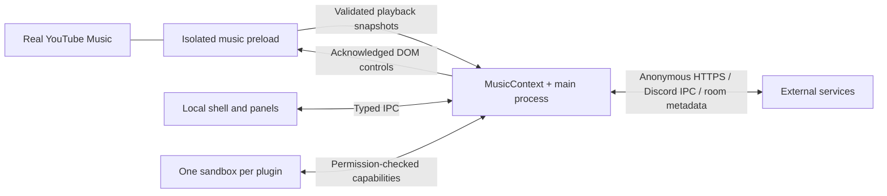

# Developing YTMusic+

## Architecture

```text
src/main/                 Native app lifecycle and privileged services
  windows/                BrowserWindow, real-site WebContentsView, navigation and schemes
  ipc/                    Explicit schemas and shell action handlers
  music/                  MusicContext and acknowledged player commands
  settings/               Atomic JSON storage, migrations, appearance and theme packages
  plugins/                Discovery/lifecycle, sandbox windows, grants, broker, ZIP installer
  networking/             Per-plugin room transport service
  blocking/               Session request filtering and a worker for EasyList compilation
  presence/               Bounded Discord IPC framing and connection
  tray/                   Tray actions
  updater/                User-confirmed update flow
  logging/                Redacted, bounded, structured log streams
src/preload/              Four individually bundled sandbox preloads
  integration/            All YouTube-specific selectors, detection and DOM controls
src/renderer/             Trusted local shell, declarative panels, settings and manager
src/plugin-runtime/       Untrusted plugin lifecycle and SDK adapters
src/shared/               Validated contracts, typed events and constants
plugins/                  Seven built-in browser plugins, each with its own manifest/source
plugin-sdk/               External type package with independently packaged declarations
client/                   RoomTransport, WebSocket implementation and pure drift math
server/                   Standalone synchronization relay and role enforcement
tests/                    Pure/service tests and the real Electron smoke scenario
```



The [Electron security checklist](https://www.electronjs.org/docs/latest/tutorial/security) informs the process boundaries. `WebContentsView` embeds the site separately from the local shell. Plugins receive independent ephemeral sessions and never share the persistent Google session. Website JavaScript receives **no** application bridge. The shell receives explicit typed app requests. Plugin renderers receive only the capability broker and lifecycle/event callbacks.

The shell reserves 52 pixels for its draggable title bar and 32 for its extension dock. YouTube Music renders its own player bar inside the website view. Appearance CSS sets its height and native layout variable to 64 pixels, so the website reserves the correct space. Blur applies to the bar, not the app root: a root filter would create a containing block and displace the fixed bar from the viewport bottom. A volume percentage is inserted beside the native speaker control. Registered sidebar entries appear in a 64-pixel extension rail. Opening a panel reserves a 380-pixel side region. Modals temporarily hide the music view; audio continues. A separate sandboxed native view displays toasts above the website. The UI renders text through DOM text nodes, not plugin-provided HTML. The native bar opens the full player page and its Up next queue without a second app player or queue panel.

Account navigation opens a dedicated sandboxed BrowserWindow using the music session and no preload. `setWindowOpenHandler` allows approved popups with secure overrides rather than synchronously navigating the opener. An explicit account-domain allowlist includes Google's sign-in and YouTube's cookie handoff domain. No UA spoofing, credential extraction or cookie copying is used. Unresponsive pages have recovery controls; `--safe-renderer` disables GPU acceleration before Electron becomes ready.

The Ad Blocker uses the same plugin runtime and permission broker. `web.blocking` controls only the music session's managed filtering service. No raw webRequest listener, cookies or request headers are exposed. EasyList compilation runs in a worker; the main process performs efficient matches. Only cancellation is applied: remote scriptlets, CSP modifications and filter redirects are ignored. Account pages, top-level navigation and media delivery are excluded. Disable/crash cleanup removes that plugin's blocking ownership.

`RoomService` starts an app-owned loopback relay on demand for the default URL. If port 8787 is occupied, it checks the existing relay's health response before using it. Remote configured relays are never replaced or started automatically. The embedded server shuts down with the app; local room codes do not make a localhost service reachable by friends on other machines.

## MusicContext

`src/preload/integration/` is the only place with YouTube DOM knowledge. It uses video/audio elements for playback commands and semantic player/queue elements for native buttons, clicking inner buttons where custom elements wrap them. A fixed read-only page-world function samples bounded public player and rendered queue metadata, artist links and the site's login boolean because page JavaScript properties are invisible across context isolation. Metadata no longer depends on the player bar or the current route's video ID. Queue commands open the native Up next tab or click the corresponding native play control. No privileged API is exposed to the page.

Volume preferences are validated, saved atomically with application settings, and restored on media replacement, load and native volume resets. A fixed page-world function receives a bounded preference and fixed control selectors to operate the native slider and mute button. Both the classic `ytmusic-player-bar` and newer `ytmusic-miniplayer` are supported. The latter uses a hidden vertical HTML range input inside its volume popup; range values are normalized using the input's minimum and maximum. The native slider maps its percentage to audio amplitude; restoring volume preserves that mapping. Media controls without a native slider use a linear fallback. Native volume input arms a short capture window so its changes update the saved preference. Automatic per-song resets restore that preference, including amplitude resets that leave the slider unchanged. Scroll-wheel steps apply anywhere over either native player bar. Outside scrolling and Ctrl+wheel stay untouched. The percentage follows the native slider and mute state, remounts after bar replacement, and is removed on preload cleanup.

A small observer watches the player bar only. A one-second discovery/sample interval handles media replacement and navigation. Media events publish changes promptly; serialized snapshots are deduplicated. There is no page-wide mutation observer or animation-frame polling.

Integration cleanup uses `pagehide` after the document actually leaves. `beforeunload` can fire for sign-in or external navigation that the app intercepts, so tearing down there would disable controls in a still-active page. Cached documents retain their integration and rediscover on `pageshow`. Electron checks use native mouse-wheel input and verify the percentage and volume remain active after intercepted sign-in navigation.

The shell and music view disable Chromium's background timer throttling so playback snapshots and short control timers keep running while the app is behind another window or in the tray.

`MusicContext.update()` diffs snapshots and emits trackChanged, playbackStarted, playbackPaused, playbackStopped, positionChanged, volumeChanged, queueChanged, navigationChanged, likeStateChanged and stateChanged. The broker filters queue data and events according to each plugin's grants. The native lyrics renderer interpolates position locally. Lyrics descriptors render in a closed shadow root in the real player page's side panel; messages are deduplicated, actions are restricted to the mounted descriptor, and disable removes the host and restores native content. Account state belongs to the application shell and is not sent to plugins.

Player commands use a UUID acknowledgement and six-second timeout. Track navigation uses a stable video ID and optional playlist ID through the normal `/watch` route. There are no internal player requests, stream extraction endpoints or download paths.

## Settings and logs

`settingsSchema` is the source of typed defaults. Version-zero settings migrate to version one; future and malformed documents are refused rather than overwritten. Writes are serialized through a temporary file and atomic rename. Plugin stores have isolated files, serialized mutations, reserved-key rejection and a 5 MB quota.

The application user-data directory contains `settings.json`, `plugins/`, `plugin-data/`, `themes/` and `logs/`, plus Electron's persistent session. Logs are JSONL, split by application/integration/plugin/room/network category or plugin ID. Each file rotates after 2 MB; the UI/export keeps the latest 500 structured entries. Authentication credentials and cookies are never intentionally collected or logged.

## Plugin development loop

`npm run dev` enables Developer Mode. Core source changes rebuild/restart Electron. Plugin source changes compile only that plugin to `dist/plugins/<id>/`; the plugin watcher reloads that sandbox. `Ctrl+Shift+R` reloads enabled plugins without reloading the website. External plugin authors should use a browser bundler in watch mode against their installed user plugin directory.

Developer Mode provides the Developer menu, separate app/site DevTools, plugin inspection, per-plugin logs/errors/permissions, and a MusicContext debug page. Changed third-party manifests invalidate prior grants and require approval. A package's ID cannot change during reload.

## Room protocol

The relay's schemas validate every incoming message. Controls are authorized on the server, never solely in the UI. Room snapshots include participants/roles, permissions, an authoritative track/position/play state, queue IDs, a revision and server timestamp. Resume tokens are private welcome-message fields, not part of participant broadcasts; disconnected identities are retained for 30 seconds before host transfer/removal.

Clients estimate server clock offset from ping round trips and calculate:

```text
expectedPosition = position + max(0, serverNow - timestamp) / 1000
```

Elapsed time is added only when playing. Drift below 250 ms is ignored, moderate drift uses a ±2% playback-rate correction, and drift above one second seeks. Thresholds are configurable. Seeks have a cooldown; mutations caused by sync are briefly suppressed from publication. State is sent on important events and at most every five seconds otherwise. Reconnect uses exponential backoff up to 15 seconds.

The default relay is private loopback. For public hosting, use TLS, firewall/reverse-proxy limits and appropriate service monitoring. Short room codes are invitation secrets, not identity authentication. The sample relay has payload, connection, participant, room and message-rate limits; it has no account database and does not relay audio. Hosting authentication and an online marketplace are future systems.

## Builds and releases

```sh
npm run typecheck
npm test
npm run build
npm run smoke
npm run build:sdk
npm run package
```

`scripts/build.mjs` produces CJS for Electron main/preloads and browser ESM for local UI/plugin hosts/plugins. Sandbox preloads are self-contained bundles. The SDK build emits all dependent declarations under its own package; run `npm pack` in `plugin-sdk/` to distribute it.

`electron-builder` configures NSIS, DMG and AppImage. Do not publish development binaries as signed production releases. Set signing credentials using the builder's platform-specific environment/configuration, set the Windows publisher identity, and configure `YTM_UPDATE_URL` with an HTTPS generic feed. Publish its update metadata and matching signed artifacts. `UpdateService` disables automatic downloading/installing and asks before downloading/restarting. A missing feed leaves the app runnable with manual updates.

## Verification boundaries

The tests run without Google credentials. `npm run smoke` uses `.smoke-data` and starts a real Electron process, checks all plugin sandboxes and UI navigation, and attempts the real music page. It reports `MUSIC_OK` only after the real site's application element is loaded and the webpage has no privileged bridge. Permission-denial errors in the smoke stderr are intentional assertions.

Use an interactive release check for Google login, actual audio playback and track metadata, native media-key conflicts, OS notification permissions, unavailable tracks/subscriptions/regions, and Discord desktop Rich Presence. Translation and romanization availability depends on providers; LRCLIB and ordinary LRC files do not supply those extra fields by default. Keep DOM selectors and Electron dependencies current.
