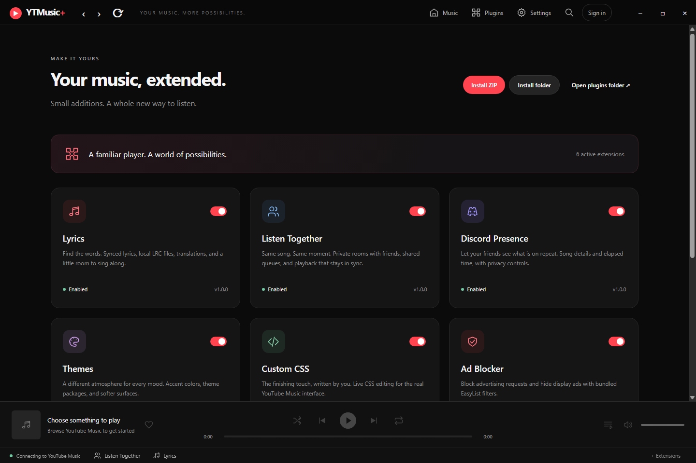

# YTMusic+

**YouTube Music, with an extension ecosystem.** A Windows-first Electron + strict TypeScript desktop wrapper that loads the real [YouTube Music website](https://music.youtube.com). Its account, search, library, queue, and playback remain the website's own experience.



## Run

Use Node.js **22.12 or newer** and npm. The Electron runtime downloads automatically when needed for the first launch or packaging run.

```sh
npm install
npm run dev
```

Development mode watches application sources and enables the Developer menu. Plugin source changes rebuild that plugin and reload its sandbox without restarting YouTube Music. Core source changes restart the application.

```sh
npm run build
npm start
```

`npm run build` type-checks and bundles the application, sandbox preloads, UI, eight plugins, and relay server. Generated files are in `dist/`. Your normal Electron session persists in the application's user-data directory. There is no account or password handling in plugin code.

Installed copies check this project's [GitHub Releases](https://github.com/ExoticBlaze/yt-music/releases) shortly after startup and every six hours. New stable versions download in the background; choose **Restart and install** when you are ready. **Later** keeps your music playing; use **Settings → General → Check for updates** to install the downloaded update later. You can disable **Automatic updates** in General settings and check manually instead.

Install the first updater-enabled `YTMusic+ Setup` installer manually to upgrade an older copy. Quit YTMusic+ from its tray menu before running it. Building or reloading the source does not update the installed application. Check the running version in **Settings → General** or hover over the YTMusic+ logo.

## Extensions included

| Plugin            | What it adds                                                                                                                                                                                                                         |
| ----------------- | ------------------------------------------------------------------------------------------------------------------------------------------------------------------------------------------------------------------------------------ |
| Lyrics            | LRCLIB and imported LRC/plain-text providers, a local metadata cache, synchronized highlighting, scrolling/follow mode, offsets, size and alignment. Translation/romanization controls appear when a provider supplies those fields. |
| Listen Together   | Short-code rooms, host/DJ/listener roles, configurable DJ permissions, shared queue metadata, timestamp-based sync, clock estimation, gradual drift correction, reconnect and identity recovery.                                     |
| Discord Presence  | Desktop Discord IPC; track/artist/album/time display options and a manual private-session switch. Requires a public Discord application ID.                                                                                          |
| Themes            | Default, Midnight and Amethyst palettes, accent controls, imported theme ZIPs/folders, background/blur/opacity/animation settings.                                                                                                   |
| Custom CSS        | Immediate CSS editing in Settings → Appearance or the plugin panel. Enable, disable, reset and import a CSS file.                                                                                                                    |
| Ad Blocker        | EasyList network rules, display-ad hiding, playback ad-response filtering before songs/videos start, native ad skipping and session counters. Google account pages and native media delivery are excluded.                           |
| Crossfade         | Overlapping song transitions with a saved 0–12 second duration, independent audio gain and automatic cleanup. Default duration: 5 seconds.                                                                                           |
| Plugin Playground | A complete SDK example with events, persistent storage, UI contributions, a command, clipboard and desktop notifications.                                                                                                            |

Lyrics, Listen Together, Themes, Custom CSS, Ad Blocker and Crossfade are enabled by default. Discord Presence and the example are opt-in. Use **Plugins** in the title bar to enable, disable, reload, inspect, install or uninstall extensions. Installed plugins require a manifest and browser ESM entry point, with permission confirmation before activation.

YouTube Music's default player bar provides artwork, track details, likes, play/pause, previous/next, shuffle, repeat, seeking and volume in a compact 64-pixel height at the bottom of the website. The current volume percentage stays visible beside the speaker icon, including after opening sign-in. Plugins remain accessible in the small extension dock below the website.

Use the native player bar to open YouTube Music's full player page with its **Song / Video**, **Up next** queue, **Lyrics**, **Comments** and **Related** controls when available for the track. Click the artist name to open their page while playback continues. Native volume and mute changes are saved between tracks and launches; scrolling anywhere over the player bar adjusts volume by 2% per wheel step. The percentage updates with the native slider and shows 0% while muted. Scrolling elsewhere keeps its normal behavior.

Lyrics appear inside YouTube Music's own **Lyrics** tab beside **Up next**. The bottom Lyrics button and Ctrl+Shift+L open that tab. Synced lines follow playback; click a line to seek. Provider, size, alignment, offset and import controls are under **Lyrics options**. Disabling the plugin restores the native tab content.

The **Crossfade** button opens a toggle and fade-length slider. It uses a second hidden, sandboxed YouTube Music page to finish the outgoing song while the visible native player advances normally. Audio gain curves blend the two songs without altering the saved volume or percentage. This requires extra buffering near a song's end. Pause, seek, skip, navigation, disable and plugin crashes cancel the transition and restore normal audio. Repeat one, ads, live streams, short tracks and unavailable audio use normal playback. The plugin receives no stream URLs, audio samples or Google credentials.

## Sign-in and freeze recovery

Click **Sign in** in the title bar or use the website's account link. Google account pages open in a separate sandboxed window sharing the persistent music session. Normal popups retain their opener behavior and account redirects include YouTube's `accounts.youtube.com` domain. Closing the account window refreshes the music page.

The title-bar account control follows YouTube Music's login state: **Sign in** is replaced with **Sign out** once signed in. Sign out opens YouTube's normal logout flow in the same app session.

An unresponsive page offers reload and browser recovery. If graphics freezes persist, quit the app completely and run:

```sh
npm start -- --safe-renderer
```

For the packaged executable, append `--safe-renderer` to its shortcut target or command. This disables hardware acceleration for that launch. Opening the website in a normal browser is a fallback and does not transfer its browser session into Electron. Google may restrict embedded sign-in; YTMusic+ does not spoof the browser or bypass that policy.

## Shortcuts and desktop features

| Shortcut     | Action                                    |
| ------------ | ----------------------------------------- |
| Ctrl+K       | Command palette                           |
| Ctrl+Shift+L | Lyrics                                    |
| Ctrl+Shift+P | Plugin manager                            |
| Ctrl+,       | Settings                                  |
| Ctrl+Shift+R | Reload enabled plugins, in Developer Mode |
| Esc          | Close an application panel/view           |

Shortcuts are customizable under Playback settings; conflicts are reported. Media keys, tray play/pause/next, notifications, back/forward navigation and close-to-tray are included. Media key registration can fail when another application owns the key; the website's native media-session handling remains available.

## Listen Together

Click **Start internet room → Copy invite** in Listen Together. Friends paste the full invite and click **Join room**, without manual relay settings or a hosting account. Version 1.4.4 uses bundled PeerJS to establish encrypted WebRTC data connections to the host. PeerJS Cloud handles signaling; the library's default STUN/TURN services help connect different networks. Keep the hosting app open. No tunnel executable or separate helper installation is needed. See [LISTEN_TOGETHER.md](LISTEN_TOGETHER.md) for usage and [PeerJS's connection FAQ](https://peerjs.com/client/faq) for network limitations.

```sh
npm run server
```

The app automatically starts the bundled relay on `127.0.0.1:8787` when you create or join a room using the default URL. There is no separate server command required for a local room. Configure the relay URL, automatic-start option and display name under **Settings → Listen Together**. `npm run server` remains available for standalone hosting.

For an optional permanent relay, [server/HOSTING.md](server/HOSTING.md) and `npm run build:relay` remain available. Deploy behind a TLS reverse proxy, set `YTM_ROOM_HOST=0.0.0.0` and a suitable `YTM_ROOM_PORT` on that server, and use the same `wss://` URL in each client. Plain `ws://` is accepted only for loopback addresses. Both P2P rooms and relays carry song IDs, names, roles and playback/queue timing, with **no audio, media URLs, Google credentials or cookies**. Each participant needs independent access to the same track.

The room's shared queue starts with the host's already-loaded queue, mirrors observed video IDs and can be edited in the room panel. Queue pages expose entries beyond the first twenty; adding a song opens its page. Host changes to the website's queue are published when its items are present in the DOM. Followers open the exact video ID and playlist through normal website navigation. The wrapper does not synthesize YouTube's private queue requests; virtualized or inaccessible native queue items may not be observable. An unavailable exact track produces a synchronization error.

## Package

```sh
npm run package
```

On Windows this produces an NSIS installer and `release/win-unpacked/YTMusic+.exe`. `npm run package:dir` builds only the unpacked app. macOS DMG and Linux AppImage targets are configured; build and sign on the appropriate platform before distributing them.

The GitHub update feed is built into packaged copies. Pushing a matching `v<version>` tag runs the Windows release workflow, which builds the installer, blockmap and `latest.yml` and uploads them to a draft GitHub Release. Review and publish that draft to make the update available. The development installer is unsigned; release maintainers can configure signing credentials before distribution. Ordinary `npm run package` builds locally without publishing. See [DEVELOPMENT.md](DEVELOPMENT.md) for the release steps and platform requirements.

## Verify

```sh
npm test
npm run smoke
npm run build:sdk
```

Unit/integration tests cover manifests, permissions, storage, migrations, saved volume, events, package paths/installation, lyrics parsing/cache identity and provider matching, protocol validation/serialization, relay roles and reconnect identity, automatic local relay startup, drift, shortcuts, ad-filter exceptions/auth exclusions, artist URL validation, crossfade timing/cancellation, equal-power curves and Discord framing. The Electron smoke scenario activates all eight plugins, exercises reload/disable cleanup, checks isolation and permission denials, navigates the manager/settings UI, and verifies the default player bar, real song metadata, position, play/pause/seek, LRCLIB lyrics, native Lyrics placement, native queue selection, artist navigation, opening the full player page and volume persistence between songs with audio output muted. A controlled media fixture also verifies account-state transitions, audio-element playback without a player bar, native controls, scroll-wheel volume, mute, replacement media elements, native-tab cleanup, extension dock bounds and ad blocking. Google's real sign-in form opens without submitting credentials. It uses a separate `.smoke-data` profile; unavailable graphics captures are reported separately from functional checks.

Crossfade smoke checks also exercise the actual settings slider, saved duration across reloads, an outgoing song loaded by the normal native player, overlapping playback/gain curves, incoming-ad fallback, unchanged volume percentage and disable cleanup. `npm start -- --smoke-test --crossfade-only --safe-renderer` runs the focused crossfade scenario.

Ad Blocker checks verify filtering before the first inline player script, fetch/JSON/XHR/config response paths, native ad skipping, paused ads, the selected song and saved volume, and enable/disable cleanup. The live checks start two real songs and play a native queue item. `npm start -- --smoke-test --adblock-only --safe-renderer` runs this focused scenario. These checks use the separate smoke profile and muted audio output.

`npm start -- --smoke-test --rooms-only --safe-renderer` verifies Listen Together with two independent app processes and separate test profiles. Both native players open the same real song and synchronize paused positions, play/pause, seek and shared queue track changes. It also checks initial queue publication, leave/host transfer and disable cleanup.

`npm start -- --smoke-test --internet-rooms-only --safe-renderer` runs the two-player scenario through PeerJS Cloud signaling and real WebRTC data channels, using a copied/pasted full invite. It checks host shutdown disconnects the guest. Unit tests cover token validation, listener/DJ permissions, reconnect identity, cancellation and retry. Both smoke processes run on one computer; different internet networks need their own connection check.

Account login, subscriber-only playback, operating-system media keys/notifications and Discord presence with a real application ID require an interactive check on your machine. Google can restrict embedded authentication; this app respects those restrictions and does not alter authentication, extract streams, download music, or circumvent DRM.

## Developer documentation

- [DEVELOPMENT.md](DEVELOPMENT.md): architecture, MusicContext, relay, testing, releases.
- [PLUGIN_DEVELOPMENT.md](PLUGIN_DEVELOPMENT.md): SDK, lifecycle, permissions and complete examples.
- [SECURITY.md](SECURITY.md): trust boundaries, package validation and reporting.

This is an independent application, unaffiliated with Google, YouTube or Discord. Provider availability and content rights remain subject to the provider's API and terms. [LRCLIB documentation](https://lrclib.net/docs) and [Discord RPC documentation](https://docs.discord.com/developers/topics/rpc) describe the external integrations.
